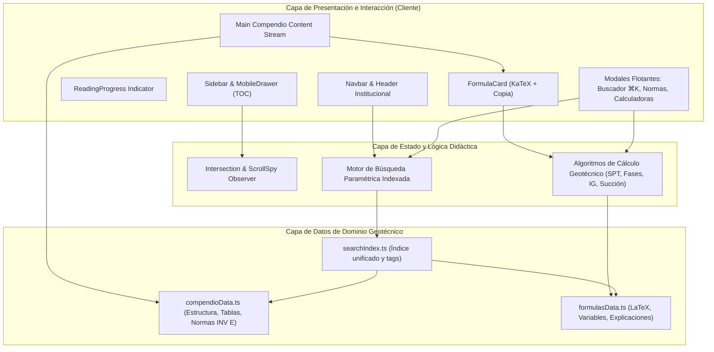
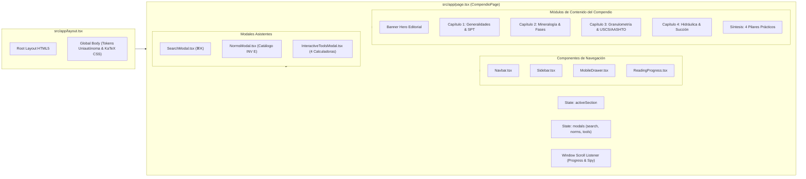
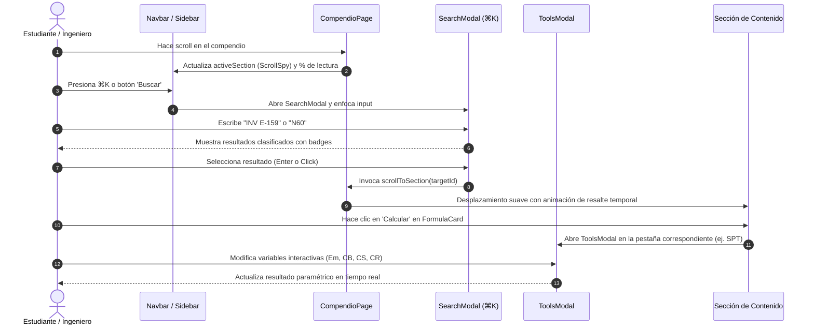

# Compendio Detallado de Mecánica de Suelos
### Portal Educativo, Técnico y Académico de Ingeniería Geotécnica

[](https://nextjs.org/)
[](https://react.dev/)
[](https://www.typescriptlang.org/)
[](https://tailwindcss.com/)
[](https://katex.org/)
[](https://www.invias.gov.co/)
[](https://www.uniautonoma.edu.co/)

---

## 1. Resumen del Proyecto y Propósito Educativo

El **Portal Educativo de Mecánica de Suelos** es una plataforma web interactiva de referencia técnica y pedagógica, diseñada para estudiantes, docentes y profesionales de la Ingeniería Civil y Geotécnica. 

Su propósito central es transformar el documento de referencia técnica **`compendio_mecanica_de_suelos_v2.pdf`** en un ecosistema digital de alta fidelidad, interactivo y accesible. Proporciona una experiencia de lectura técnica inmersiva enriquecida con:

1. **Rigor Geotécnico Canónico**: Transcripción y contextualización rigurosa de las leyes fundamentales de Karl Terzaghi, Arthur Casagrande, Skempton y la mecánica de suelos moderna.
2. **Normalización Técnica Colombiana**: Integración completa con las especificaciones del **Instituto Nacional de Vías (INVIAS - Normas INV E)**.
3. **Didáctica Matemática Interactiva**: Renderizado tipográfico de precisión mediante **KaTeX** y herramientas de simulación paramétrica en tiempo real (corrección de energía SPT, relaciones volumétricas/gravimétricas, clasificación de subrasantes viales por Índice de Grupo y curvas de succión no saturada).
4. **Experiencia de Usuario Académica**: Navegación fluida asistida por un buscador instantáneo multimodal con atajo de teclado (`⌘K`), seguimiento de lectura en tiempo real (*ScrollSpy* y *ReadingProgress*) y diseño adaptativo (*Mobile First*) regido por la identidad institucional de la **Corporación Universitaria Autónoma del Cauca (Uniautónoma)**.

---

## 2. Arquitectura del Sistema

La solución está construida sobre **Next.js 16 App Router**, aprovechando el compilador **Turbopack**, renderizado estático optimizado, tipado estricto con **TypeScript**, componentes modulares en **React 19** y estilos atómicos con **Tailwind CSS v4**.

### 2.1 Diagrama de Módulos del Sistema



### 2.2 Arquitectura de Componentes y Flujo de Datos



### 2.3 Diagrama de Navegación y Eventos de Usuario



---

## 3. Mapeo Integral de Contenidos y Equivalencia con el Compendio PDF

El portal reproduce con absoluta fidelidad y rigor pedagógico el contenido íntegro de las 6 páginas de **`compendio_mecanica_de_suelos_v2.pdf`**:

| Página PDF | Capítulo / Sección en Portal | ID de Sección | Conceptos Clave y Ecuaciones Implementadas | Componentes & Datos de Respaldo |
| :---: | :--- | :---: | :--- | :--- |
| **Pág. 1** | **Capítulo 1**: Generalidades, Evolución Histórica y Exploración Geotécnica | `capitulo-1` | • Definición canónica de Karl Terzaghi (*Erdbaumechanik*, 1925).<br>• Línea cronológica: Etapa Pre-clásica (S. XVII-XVIII), Terzaghi (1925: $\sigma' = \sigma - u$), Casagrande & Harvard (1936), Skempton, Bjerrum y Fellenius.<br>• Ecuación de Capacidad Portante Skempton-CPT: $$R_d = K_c \cdot N_c \cdot S_u + \gamma \cdot D$$ | • `FormulaCard` (`formula-skempton`)<br>• Timeline interactivo estilizado<br>• Citas canónicas en bloque |
| **Pág. 2** | **1.2** Exploración de Campo, Métodos de Muestreo y Normativa | `sec-1-2` | • Métodos de exploración: calicatas, barrenos manuales y mecánicos.<br>• Matriz comparativa de Muestras: Alteradas, Inalteradas en Bloque e Inalteradas en Tubo Shelby.<br>• Ensayo SPT (masa 63.5 kg, caída 76 cm).<br>• Fórmula de corrección energética de golpes SPT: $$N_{60} = N \cdot \left(\frac{E_m}{60}\right) \cdot C_B \cdot C_S \cdot C_R$$ | • Tabla interactiva `SAMPLING_TABLE`<br>• `FormulaCard` (`formula-spt`)<br>• Calculadora SPT en `InteractiveToolsModal` |
| **Pág. 2-3**| **Capítulo 2**: Mineralogía de Arcillas y Relaciones Gravimétricas y Volumétricas | `capitulo-2`<br>`sec-2-1` | • Cristalografía: Tetraedros de Sílice ($Si^{4+}+4O^{2-}$), Hojas octaédricas de Gibsita ($Al^{3+}$) y Brucita ($Mg^{2+}$).<br>• Matriz de Minerales de Arcilla: Caolinita (1:1), Montmorillonita (2:1 expansiva), Illita (2:1 con $K^+$), Vermiculita (2:1 modificada). | • Tabla comparativa `CLAY_MINERALS_TABLE`<br>• Badges de estabilidad y expansividad mineral |
| **Pág. 3** | **2.2** Composición Trifásica y Relaciones Fásicas | `sec-2-2` | • Diagrama trifásico: Sólidos, Agua y Aire.<br>• Formulario completo de 11 relaciones fásicas:<br>1. Porosidad: $n = (V_v / V_T) \cdot 100\%$<br>2. Relación de Vacíos: $e = V_v / V_s$<br>3. Conversiones: $n = \frac{e}{1+e}$, $e = \frac{n}{1-n}$<br>4. Grado de Saturación: $S_r = (V_w / V_v) \cdot 100\%$<br>5. Contenido de Humedad: $w = (P_w / P_s) \cdot 100\%$<br>6. Gravedad Específica: $G_s = P_s / (V_s \gamma_w)$<br>7. Relación Fundamental: $e \cdot S_r = w \cdot G_s$<br>8. Peso Húmedo: $\gamma_m = \left[\frac{G_s + e S_r}{1 + e}\right] \gamma_w$<br>9. Peso Seco: $\gamma_d = \left[\frac{G_s}{1 + e}\right] \gamma_w = \frac{\gamma_m}{1 + w}$<br>10. Peso Saturado: $\gamma_{sat} = \left[\frac{G_s + e}{1 + e}\right] \gamma_w$<br>11. Peso Sumergido: $\gamma' = \left[\frac{G_s - 1}{1 + e}\right] \gamma_w$ | • `FormulaCard` individual para cada grupo fásico<br>• Calculadora trifásica en `InteractiveToolsModal` con resolución simultánea |
| **Pág. 3** | **2.3** Propiedades Índice entre Suelos y Rocas | `sec-2-3` | • Porosidad accesible ($V_{ha}$) vs inaccesible ($V_{hi}$).<br>• Porosidad eficaz: $n_e = V_{ha} / V_T$.<br>• Correlación inversamente proporcional con la resistencia a compresión simple ($\sigma_c$). | • Cuadro comparativo suelos vs matrices rocosas |
| **Pág. 3-4**| **Capítulo 3**: Estructura, Granulometría y Clasificación de Suelos | `capitulo-3`<br>`sec-3-1` | • Fracción gruesa por Tamizado mecánico (INV E-123).<br>• Coeficientes de gradación: $$C_u = \frac{D_{60}}{D_{10}} \quad,\quad C_c = \frac{(D_{30})^2}{D_{60} \cdot D_{10}}$$ • Criterios: Gravas ($C_u > 4$), Arenas ($C_u > 6$), Curvatura ($1 \le C_c \le 3$).<br>• Suelos finos: Hidrómetro de sedimentación (Ley de Stokes $v = K \cdot D^2$, corrección de menisco $C_m \approx +1$, defloculante $C_d = \text{NaPO}_3$).<br>• Ensayo de Azul de Metileno (INV E-235). | • `FormulaCard` (`formula-cu-cc`, `formula-stokes`)<br>• Guía paso a paso de laboratorio para correcciones de hidrómetro |
| **Pág. 4** | **3.2** Límites de Atterberg y Ensayos de Consistencia | `sec-3-2` | • Estados de consistencia: Líquido $\to$ LL $\to$ Plástico $\to$ LP $\to$ Semisólido $\to$ LC $\to$ Sólido.<br>• Parámetros volumétricos de contracción:<br>$$IP = LL - LP$$ $$LC = w - \left[\frac{(V - V_0)\rho_w}{M_0}\right] \cdot 100$$ $$R = \frac{M_0}{V_0 \rho_w} \quad,\quad CV = (w_1 - LC) \cdot R$$ $$CL = 100 \cdot \left[1 - \left(\frac{100}{100 + CV}\right)^{1/3}\right]$$ | • Diagrama secuencial de estados de consistencia<br>• `FormulaCard` (`formula-atterberg-contraccion`) |
| **Pág. 4-5**| **3.3** Sistemas de Clasificación de Suelos (USCS y AASHTO) | `sec-3-3` | • Sistema USCS (ASTM D-2487): GW, GP, SW, SP, CL, CH, ML, MH.<br>• Sistema AASHTO (M-145): Suelos granulares (A-1 a A-3) y limo-arcillosos (A-4 a A-7).<br>• Ecuación oficial del Índice de Grupo (IG): $$IG = (F - 35)[0.2 + 0.005(LL - 40)] + 0.01(F - 15)(IP - 10)$$ (Regla $IG < 0 \to 0$; Grupos A-2-6 / A-2-7 solo usan término $IP$). | • Tabla interactiva `SOIL_CLASSIFICATION_TABLE`<br>• `FormulaCard` (`formula-indice-grupo`)<br>• Calculadora interactiva de IG en `InteractiveToolsModal` |
| **Pág. 5** | **Capítulo 4**: El Agua en los Suelos: Tensión Superficial, Capilaridad y Succión | `capitulo-4`<br>`sec-4-1` | • Los 4 aspectos geotécnicos fundamentales:<br>1. Flujo y Permeabilidad (filtración).<br>2. Esfuerzo Efectivo y Resistencia ($\tau = c' + \sigma' \tan\phi'$).<br>3. Asentamientos por consolidación primaria.<br>4. Presiones hidrostáticas y empujes en contenciones. | • Tarjetas de impacto práctico en ingeniería civil |
| **Pág. 5** | **4.2** Tensión Superficial y Ascenso Capilar | `sec-4-2` | • Física del menisco cóncavo y desequilibrio molecular ($T_s \approx 0.073 \text{ N/m}$).<br>• Ecuación físico-matemática del ascenso capilar: $$h_c = \frac{4 T_s \cos\alpha}{d_c \gamma_w} \approx \frac{C}{e \cdot D_{10}}$$ • Efectos según granulometría: Gravas ($< 10\text{ cm}$), Arenas finas ($0.3 - 1.0\text{ m}$), Arcillas ($3.0 - 10.0\text{ m}$). | • `FormulaCard` (`formula-capilaridad`)<br>• Visualizador de rangos de ascenso capilar |
| **Pág. 5-6**| **4.3** Succión en Suelos no Saturados y Fenómeno de Licuación | `sec-4-3` | • Componentes de la Succión Total: Succión Matricial ($u_a - u_w$) y Succión Osmótica ($\psi_o$).<br>• Ensayo de succión con Papel de Filtro Whatman No. 42 (INV E-159): $$\begin{cases} \log h = 5.327 - 0.0779 \cdot w_f & \text{si } w_f \le 45.3\% \\ \log h = 2.412 - 0.0135 \cdot w_f & \text{si } w_f > 45.3\% \end{cases}$$ $$h = 10^{\log h} \quad [\text{kPa}]$$ • Criterio de Licuación dinámica: $$u \to \sigma \implies \sigma' = \sigma - u = 0 \implies \tau = 0$$ | • `FormulaCard` (`formula-papel-filtro`, `formula-licuacion`)<br>• Calculadora de succión no saturada en `InteractiveToolsModal`<br>• Alerta técnica de licuación dinámica |
| **Pág. 6** | **Síntesis**: Conclusiones y Síntesis de Aplicabilidad Práctica | `conclusiones`<br>`sec-conclusiones` | • Síntesis estructurada en los **4 Pilares de la Práctica Geotécnica**:<br>1. Exploración y muestreo de calidad con normalización SPT.<br>2. Control mineralógico de arcillas expansivas.<br>3. Clasificación unificada y consistencia para vías y fundaciones.<br>4. Dinámica hídrica, succión y prevención de fallas por licuación. | • Panel de conclusiones ejecutivas numeradas |

---

## 4. Inventario de Normas Técnicas del Instituto Nacional de Vías (INV E)

El compendio articula **9 normas técnicas oficiales** del Instituto Nacional de Vías (INVIAS), normalizadas bajo el código **INV E**. En el portal están catalogadas en `src/data/compendioData.ts` y cuentan con acceso directo desde el modal de normas (`NormsModal.tsx`):

| Código de Norma | Nombre Oficial de la Norma Técnica | Versión / Año | Sección Relacionada | Objeto Geotécnico y Protocolo Experimental |
| :---: | :--- | :---: | :---: | :--- |
| **`INV E-101`** | **Investigación y Muestreo de Suelos** | Vigente | `sec-1-2` | Protocolos de exploración de campo para obtención de muestras alteradas mediante palas, posteadora o barrenos helicoidales para ensayos de clasificación. |
| **`INV E-104`** | **Toma de Muestras Inalteradas en Bloque** | Vigente | `sec-1-2` | Procedimiento de corte y tallado manual en calicatas a cielo abierto, parafinado y embalaje rígido para preservar estructura resistente, densidad y humedad natural. |
| **`INV E-105`** | **Toma de Muestras con Tubo Shelby de Pared Delgada** | Vigente | `sec-1-2` | Hincado a presión hidráulica de tubos de acero sin costura en suelos cohesivos blandos a medianamente consistentes para ensayos triaxiales y consolidación. |
| **`INV E-123`** | **Análisis Granulométrico de Suelos por Tamizado** | Vigente | `sec-3-1` | Separación mecánica fraccionada mediante serie estándar de tamices hasta la malla No. 200 (75 $\mu\text{m}$) para trazado de curvas y cálculo de $C_u$ y $C_c$. |
| **`INV E-125`** | **Determinación del Límite Líquido (LL)** | Vigente | `sec-3-2` | Ensayo de copa de Casagrande con ranurador trapezoidal calibrado para determinar el contenido de agua que produce el cierre de 12.7 mm a los 25 golpes. |
| **`INV E-126`** | **Determinación del Límite Plástico (LP) e Índice de Plasticidad (IP)** | Vigente | `sec-3-2` | Rodado manual de cilindros de suelo de 3.2 mm ($\approx 1/8''$) hasta observar agrietamiento superficial, deduciendo $IP = LL - LP$. |
| **`INV E-159`** | **Determinación de la Succión del Suelo Mediante Papel de Filtro** | **2013** | `sec-4-3` | Calibración higrométrica de equilibrio a $20 \pm 3^\circ\text{C}$ con papel Whatman No. 42 para medir succión matricial y total hasta 100,000 kPa. |
| **`INV E-180`** | **Determinación del Índice de Grupo (IG) AASHTO** | Vigente | `sec-3-3` | Algoritmo cuantitativo para tasar la calidad de un suelo fino como subrasante vial en función del pasa tamiz #200 ($F$), Límite Líquido ($LL$) e Índice de Plasticidad ($IP$). |
| **`INV E-235`** | **Valor de Azul de Metileno en Suelos Finos** | **2013** | `sec-3-1` | Medición espectrofotométrica/titulación con tinte azul de metileno en la fracción fina para determinar el área superficial específica y la presencia de arcillas expansivas (esmectitas). |

---

## 5. Manual de Componentes de UI y Experiencia de Usuario

La interfaz de usuario ha sido concebida bajo principios de ergonomía visual, accesibilidad WCAG y rendimiento web óptimo.

### 5.1 Buscador Instantáneo Omnipresente (`SearchModal.tsx`)
* **Atajo Global de Teclado**: Se activa en cualquier momento mediante la combinación **`⌘K`** (macOS) o **`Ctrl+K`** (Windows/Linux), así como haciendo clic en la barra del encabezado.
* **Búsqueda Indexada en Tiempo Real**: Opera sobre `src/data/searchIndex.ts` evaluando títulos, subtítulos, descripciones y palabras clave (*tags*) normalizadas.
* **Navegación Total por Teclado**: Soporta teclas de flechas arriba/abajo (`↑`/`↓`), confirmación mediante `Enter` para saltar a la sección y `Escape` para cerrar.
* **Clasificación por Badges**: Etiqueta visualmente si el resultado corresponde a una *Norma INV E*, una *Ecuación*, un *Concepto Clave* o una *Sección de Capítulo*.

### 5.2 Barra de Progreso de Lectura (`ReadingProgress.tsx`)
* Ubicada en la parte superior fija de la pantalla (`top-0`, `z-50`).
* Monitoriza de forma reactiva la altura de desplazamiento del usuario y actualiza una barra estilizada en color naranja institucional (`#F58220`) con gradiente sutil y transición fluida.

### 5.3 Navegación Lateral y ScrollSpy (`Sidebar.tsx` & `MobileDrawer.tsx`)
* **Desktop Sticky Sidebar**: Menú lateral fijado que desglosa los 4 capítulos, sus subsecciones y la síntesis con numeración jerárquica.
* **ScrollSpy Dinámico**: Detecta continuamente el encabezado de sección que entra en el viewport del usuario y resalta automáticamente el enlace correspondiente.
* **Mobile Drawer**: Versión responsive optimizada para pantallas táctiles con apertura mediante botón hamburguesa y cierre automático al navegar.
* **Scroll Suave y Resalte Visual**: El método `scrollToSection` realiza un desplazamiento compensado (`yOffset = -80px`) para respetar el encabezado flotante y aplica un halo temporal de foco en la sección destino (`ring-2 ring-[#F58220]`).

### 5.4 Renderizado Matemático KaTeX (`MathBlock.tsx` & `FormulaCard.tsx`)
* **Integración Nativa KaTeX**: Renderizado de fórmulas complejas (fracciones, sumatorias, matrices, casos por partes y notación tensorial) sin sobrecarga de imágenes, generando código HTML/MathML accesible.
* **FormulaCard Enriquecida**:
  - Encabezado con categoría e insignia de la norma INV E asociada.
  - Botón de **Copia de LaTeX** al portapapeles con feedback visual interactivo.
  - Glosario explicativo de variables y unidades del Sistema Internacional.
  - Botón directo de acción **"Calcular"** que abre automáticamente la calculadora asociada a la fórmula.

### 5.5 Catálogo Modal de Normas INV E (`NormsModal.tsx`)
* Modal emergente que presenta el catálogo de las 9 normas INVIAS citadas.
* Permite al estudiante explorar el alcance de cada norma y saltar con un clic (`Ver Sección`) directamente a la parte del compendio donde se fundamenta dicha especificación técnica.

### 5.6 Suite de Calculadoras Geotécnicas Didácticas (`InteractiveToolsModal.tsx`)
Diseñada como una herramienta de verificación paramétrica que permite experimentar con variables geotécnicas reales:

```
┌─────────────────────────────────────────────────────────────────────────────┐
│ Calculadoras Geotécnicas Interactivas                               [X]     │
├─────────────────┬─────────────────┬───────────────────┬─────────────────────┤
│ [1. SPT N60]    │ [2. Rel. Fases] │ [3. IG AASHTO]    │ [4. Succión Filtro] │
└─────────────────┴─────────────────┴───────────────────┴─────────────────────┘
```

1. **Corrección de Energía SPT ($N_{60}$)**:
   - Variables de entrada: Número de golpes de campo ($N$), Eficiencia de martillo ($E_m$), Diámetro de perforación ($C_B$), Muestreador con/sin liner ($C_S$) y Longitud de varilla ($C_R$).
   - Resultado: Número de golpes normalizado $N_{60}$.
2. **Relaciones Fásicas y Pesos Volumétricos**:
   - Variables de entrada: Relación de vacíos ($e$), Gravedad específica ($G_s$) y Grado de saturación ($S_r$).
   - Resultados simultáneos: Porosidad ($n$), Contenido de humedad ($w$), Peso seco ($\gamma_d$), Peso húmedo ($\gamma_m$), Peso saturado ($\gamma_{sat}$) y Peso sumergido ($\gamma'$).
3. **Índice de Grupo AASHTO (INV E-180)**:
   - Variables de entrada: Porcentaje pasa tamiz #200 ($F$), Límite Líquido ($LL$), Índice de Plasticidad ($IP$) y selector para grupos especiales A-2-6 / A-2-7.
   - Resultado: Valor entero de $IG$ y calificación cualitativa de aptitud como subrasante vial (Excelente a Pésima).
4. **Curvas de Succión con Papel de Filtro (INV E-159)**:
   - Variable de entrada: Humedad del papel de filtro Whatman No. 42 ($w_f$).
   - Algoritmo: Conmutación automática según el umbral $w_f \le 45.3\%$ o $w_f > 45.3\%$.
   - Resultado: Succión en escala logarítmica ($\log h$) y presión de succión en kiloPascales ($h \text{ [kPa]}$).

---

## 6. Guía de Estilo y Sistema de Diseño Institucional (Uniautónoma)

El diseño del portal implementa formalmente la identidad cromática y visual de la **Corporación Universitaria Autónoma del Cauca**:

### 6.1 Paleta Cromática Institucional

| Nombre del Token | Código Hexadecimal | Propósito y Aplicación en la Interfaz | Mapeo en Tailwind CSS |
| :--- | :---: | :--- | :--- |
| **Azul Noche (Navy)** | `#062653` | Encabezados principales, Navbar fija, fondos oscuros de alta jerarquía y botones primarios. | `bg-[#062653]`, `text-[#062653]` |
| **Azul Corporativo** | `#0756A5` | Elementos de selección activa, bordes activos, iconos interactivos y enlaces secundarios. | `text-[#0756A5]`, `border-[#0756A5]` |
| **Naranja Institucional** | `#F58220` | Color de acento institucional: badges destacados, botones de acción (*CTA*), barra de progreso y halos de foco. | `bg-[#F58220]`, `text-[#F58220]` |
| **Lienzo (Canvas)** | `#F5F7FC` | Fondo base general de lectura técnica de baja fatiga visual. | `bg-[#F5F7FC]` |
| **Superficie (White)** | `#FFFFFF` | Contenedores de tarjetas, modales y tablas de datos. | `bg-white` |
| **Texto Primario** | `#142B4D` | Texto de lectura técnica de alto contraste (títulos y cuerpo de texto). | `text-[#142B4D]` |
| **Texto Secundario** | `#4F6585` | Subtítulos, etiquetas explicativas y metadatos de fórmulas. | `text-slate-600`, `text-[#4F6585]` |

### 6.2 Tokens CSS en `src/app/globals.css`
Los tokens están integrados con la directiva `@theme` de Tailwind CSS v4:
```css
@import "tailwindcss";
@import "katex/dist/katex.min.css";

:root {
  --navy: #062653;
  --corp-blue: #0756A5;
  --accent-orange: #F58220;
  --canvas-bg: #F5F7FC;
  --surface-white: #FFFFFF;
  --text-primary: #142B4D;
  --text-secondary: #4F6585;
}
```

---

## 7. Estructura de Directorios del Proyecto

```
martin_liber/
├── compendio_mecanica_de_suelos_v2.pdf  # Documento técnico fuente original
├── extracted_pdf_text.txt               # Extracción textual estructurada por páginas
├── next.config.ts                       # Configuración de compilación Next.js
├── package.json                         # Dependencias, scripts y metadatos
├── tsconfig.json                        # Configuración estricta de TypeScript
├── public/                              # Recursos estáticos e iconos
└── src/
    ├── app/
    │   ├── globals.css                  # Estilos globales, temas y KaTeX CSS
    │   ├── layout.tsx                   # Layout raíz, Viewport y metadatos SEO
    │   └── page.tsx                     # Página principal integral del compendio
    ├── components/
    │   ├── FormulaCard.tsx              # Tarjeta de presentación matemática
    │   ├── InteractiveToolsModal.tsx    # Modal con suite de 4 calculadoras geotécnicas
    │   ├── MathBlock.tsx                # Wrapper de renderizado KaTeX con función de copia
    │   ├── MobileDrawer.tsx             # Menú de navegación lateral deslizante para móvil
    │   ├── Navbar.tsx                   # Barra superior con búsqueda y accesos rápidos
    │   ├── NormsModal.tsx               # Catálogo e índice modal de Normas INV E
    │   ├── ReadingProgress.tsx          # Barra superior indicadora de avance de lectura
    │   ├── SearchModal.tsx              # Buscador instantáneo modal con atajo ⌘K
    │   └── Sidebar.tsx                  # Navegación fija con índice y ScrollSpy
    └── data/
        ├── compendioData.ts             # Datos estructurados: capítulos, tablas y normas
        ├── formulasData.ts              # Catálogo de fórmulas en notación LaTeX y variables
        ├── searchIndex.ts               # Índice estructurado de búsqueda con etiquetas
        └── soilCompendiumData.ts        # Barril de exportación para pruebas y compatibilidad
```

---

## 8. Guía de Desarrollo Local y Comandos de Producción

### 8.1 Requisitos del Sistema
* **Node.js**: Versión `18.18.0` o superior (se recomienda Node.js 20 LTS o 22 LTS).
* **Gestor de Paquetes**: `npm`, `pnpm` o `yarn`.

### 8.2 Instalación de Dependencias
Clone el repositorio o ingrese al directorio del proyecto y ejecute:

```bash
# Instalación limpia de dependencias
npm install
```

### 8.3 Servidor de Desarrollo
Para iniciar el servidor de desarrollo local con recarga en caliente (*Hot Module Replacement*) potenciada por **Turbopack**:

```bash
npm run dev
```

Abra su navegador web en [http://localhost:3000](http://localhost:3000) para acceder al portal.

### 8.4 Validación de Tipos y Linter
Para garantizar la integridad del código TypeScript y las buenas prácticas de React:

```bash
# Comprobación de reglas de ESLint
npm run lint
```

### 8.5 Compilación para Producción (Build)
Para generar una versión de producción optimizada con pre-renderizado estático completo:

```bash
npm run build
```

La salida generará artefactos estáticos ultra-eficientes dentro de la carpeta `.next`.

### 8.6 Ejecución del Servidor en Producción
Una vez finalizada la compilación, puede probar el bundle de producción localmente ejecutando:

```bash
npm run start
```

---

## 9. Despliegue en Producción

### Despliegue en Vercel (Recomendado)
El proyecto está optimizado para despliegue instantáneo en la nube de Vercel:
1. Conecte su repositorio de GitHub a Vercel.
2. Vercel detectará automáticamente la configuración de **Next.js**.
3. Deje el comando de compilación por defecto (`npm run build`) y la carpeta de salida (`.next`).
4. Haga clic en **Deploy**.

### Despliegue en Servidores Propios / Docker
Si se implementa un contenedor Docker, se puede utilizar una imagen base ligera de Node.js Alpine:

```dockerfile
FROM node:20-alpine AS builder
WORKDIR /app
COPY package*.json ./
RUN npm ci
COPY . .
RUN npm run build

FROM node:20-alpine AS runner
WORKDIR /app
ENV NODE_ENV=production
ENV PORT=3000
COPY --from=builder /app/public ./public
COPY --from=builder /app/.next ./.next
COPY --from=builder /app/node_modules ./node_modules
COPY --from=builder /app/package.json ./package.json

EXPOSE 3000
CMD ["npm", "run", "start"]
```

---

## 10. Créditos y Referencias Académicas

* **Documento Base**: *Compendio Detallado de Mecánica de Suelos* (Versión 2.0).
* **Normativa Técnica**: Instituto Nacional de Vías (INVIAS) — *Normas de Ensayo de Materiales para Carreteras (INV E)*.
* **Marco Teórico**:
  - Karl Terzaghi (1925), *Erdbaumechanik auf bodenphysikalischer Grundlage*.
  - Arthur Casagrande (1936, 1948), *Classification and Identification of Soils*.
  - Alec W. Skempton, *The Colloidal Activity of Clays* & *CPT Foundation Capacity*.
  - Fredlund & Rahardjo, *Soil Mechanics for Unsaturated Soils*.
* **Identidad Institucional**: Corporación Universitaria Autónoma del Cauca (Uniautónoma).

---
*Portal Educativo de Mecánica de Suelos — Desarrollado con Next.js 16, React 19, TypeScript, Tailwind CSS y KaTeX.*
